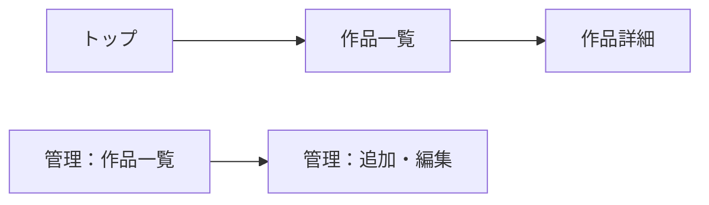

[A_設計書テンプレート.md](https://github.com/user-attachments/files/34271374/A_.md)
# 設計書 ― ［クライアント名］さんのポートフォリオサイト

> この設計書は、あなたが「何を、誰のために、なぜ作るのか」を記録するものです。
> 同時に、**生成AIへの指示書**にもなります。書かれていないことは、AIにも伝わりません。
> 各回の授業で少しずつ書き足し、変更したときは「7. 変更履歴」に残してください。
> 第2回の授業では、ワークシート②③④に手書きした内容を、1〜3章にそのまま転記します。

| 項目 | 記入欄 |
| --- | --- |
| デザイナー（あなた） | WEI XIAO |
| クライアント | |
| リポジトリ | |
| 最終更新日 | |

---

## 1. ヒアリング記録（第2回）

クライアントに聞いた内容を、できるだけ本人の言葉のまま記録します。

### 1.1 基本情報

| 質問 | 回答 |
| --- | --- |
| 希望する業界・職種 |餐饮，点心制作行业 |
| その業界を選んだ理由 | 用户范围广阔，单品利润高，下沉市场宽广 |
| 自分の強みだと思うこと（3つまで） | 擅长制作甜点、帮助家人管理过面包房，曾经主动进行过市场调研、能制定合理的计划，变通能力强，能抓住该行业的流行风向|
| 周りからよく言われる長所 | 热情有行动力，遇到困难能理性分析寻找解决方法|
| 載せたい作品（作品名と、見てほしい点） | 当前正流行的点心图片，简单的制作流程展示，对于原材料健康性的介绍|
| 載せたくないこと・見せ方で避けたいこと | 避免展示不成熟的作品，避免让作品集变成单纯的图片展示|

### 1.2 公開範囲とAIに渡してよい情報

| 情報 | サイトに載せてよい | AIに渡してよい |
| --- | --- | --- |
| 氏名 | WEI XIAO | WEI XIAO |
| 顔写真 | O | O |
| 連絡先 | 0908154XXXX | 0908154XXXX |
| 作品の画像 | O | O |
| その他（　　　） | O | O |

### 1.3 ヒアリングで気づいたこと

- 本人がまだ言葉にできていないが、話の中から見えてきた強み：善于听取他人的建议并灵活修改
- 追加で確認したいこと：暂时没有

---

## 2. ステークホルダー像（第2回）

このサイトを見るのは、**クライアントが希望する業界の採用担当者**です。

| 項目 | 記入欄 | 根拠（調べた情報源、URLなど） |
| --- | --- | --- |
| 業界・企業の例 | 西式点心（饼干类为主） 奥利奥 |
| 採用担当者が知りたいこと（重要な順に3つ） | お菓子作りの技術　作品の完成度　仕事への意欲 |
| 1人あたりにかけられる閲覧時間の想定 | 1～3分钟程度 |
| 閲覧環境（PC／スマートフォン） | PC |
| マイナスの印象を与えそうなこと | 图片模糊、页面杂乱、作品说明不清楚 |

---

## 3. 伝えたいこと（第2回）

### 3.1 一文のメッセージ

> 採用担当者に、この人は「お菓子作りへの情熱と行動力があり、冷静に考えて行動できる人」だと感じてもらう。

### 3.2 情報の優先順位

2で調べた「採用担当者が知りたいこと」と、1のクライアントの強みを突き合わせて決めます。

| 優先 | 伝える情報 | 2のどの項目に応えるか |
| --- | --- | --- |
| 1 | 具体点心的图片| 制作技术 |
| 2 | お菓子の製作工程や工夫した点 |作品の完成度 |
| 3 | お菓子作りへの情熱や、これまでの経験|仕事への意欲 |
| 載せない |個人情報 | 載せない理由：個人情報保護のため |

---

## 4. 情報構造と画面遷移（第2回）

### 4.1 画面一覧

| 画面 | 誰が使うか | 目的 | 主な表示内容 |
| --- | --- | --- | --- |
| 画面 | 誰が使うか | 目的 | 主な表示内容 |
| トップ | 採用担当者 |クライアントの特徴や強みを伝える |自己紹介、プロフィール、代表作品の写真|
| 作品一覧 | 採用担当者 | 制作したお菓子をまとめて紹介する|お菓子の写真、作品名、簡単な説明 |
| 作品詳細 | 採用担当者 |作品の特徴や制作方法を詳しく伝える | 材料、製作工程、工夫した点|
| 管理：作品一覧 | クライアント | 登録した作品を確認・管理する| 作品一覧、編集ボタン、削除ボタン|
| 管理：作品の追加・編集 | クライアント |作品の情報を新しく登録・変更する |作品名、作品写真、材料、製作工程、保存ボタン |

### 4.2 画面遷移

手描きワイヤーフレームの写真（第2回）をここに貼る。第3回以降はFigmaのリンクに置きかえてよい：
        ┌──────────────┐
        │ トップ       │
        │ （首页）     │
        └──────┬───────┘
               │
               ▼
        ┌──────────────┐
        │ 作品一覧     │
        │ （作品列表） │
        └──────┬───────┘
               │
               ▼
        ┌──────────────┐
        │ 作品詳細     │
        │ （作品详情） │
        └──────────────┘


        ┌──────────────┐
        │ 管理：作品一覧│
        └──────┬───────┘
               │
               ▼
        ┌──────────────┐
        │ 管理：作品の │
        │ 追加・編集   │
        └──────────────┘




※ 上の図は例です。自分の設計に合わせて書き換えてください。

---

## 5. データ構造とAPI仕様（第5回）

### 5.1 作品データ

| 項目名 | 型 | 必須 | 説明 | 入力の制約（文字数など） |
| --- | --- | --- | --- | --- |
| id | 文字列 | ○ | 作品を識別する番号 | 自動で付与 |
| title | 文字列 | ○ | 作品名 | 1～50文字 |
| year | 文字列 | ○ | 制作年 | 4桁の数字 |
| tools | 配列 | ○ | 使用したツール | 文字列の配列 |
| role | 文字列 | ○ | 制作における役割 | 1～100文字 |
| summary | 文字列 | ○ | 作品の概要 | 1～200文字 |
| what | 文字列 | ○ | 制作内容 | 1～300文字 |
| point | 文字列 | ○ | 作品の工夫・ポイント | 1～300文字 |

### 5.2 API

| メソッド | パス | 目的 | 送るデータ | 返るデータ | 主なステータスコード |
| --- | --- | --- | --- | --- | --- |
| GET | /api/works | 作品一覧を取得 | なし | 作品の配列 | 200 |
| GET | /api/works/:id | 指定した作品を取得 | URLのID | 作品データ | 200, 404 |
| POST | /api/works | | | | |
| PUT | /api/works/:id | | | | |
| DELETE | /api/works/:id | | | | |

### 5.3 エラーのときにユーザーへどう伝えるか（第6回）

| 起こりうる失敗 | 誰に表示されるか | 表示する文言 | 次にとれる行動 |
| --- | --- | --- | --- |
| 必須項目が空のまま保存した | クライアント | | |
| サーバにつながらない | 採用担当者 | | |
| | | | |

---

## 6. 確認すること（ユーザーテストの計画）

| テスト | 実施回 | 誰がどの役で | 確かめること | 成功の目安 |
| --- | --- | --- | --- | --- |
| 5秒テスト | 第3回 | 採用担当者役 | 3.1のメッセージが伝わるか | 5秒見た印象が、3.1に近い言葉で返ってくる |
| 公開画面のテスト | 第4回 | 採用担当者役 | 優先1〜3の情報に、迷わずたどり着けるか | |
| 管理画面のテスト | 第6回 | クライアント本人 | 作品の追加・編集を、説明なしでできるか | |

テストの結果は、GitHubのIssueに1件ずつ記録してください。GitHubを使い始める前（第3回の5秒テスト）の結果は、7. 変更履歴に書きます。

---

## 7. 変更履歴

テストの結果や、クライアントからの要望で設計を変えたときに記録します。

| 日付 | 何を変えたか | きっかけ（Issue番号） | 理由 | 対応したコミット |
| --- | --- | --- | --- | --- |
| | | | | |

---

## 付録：AIに渡すときの指示の例

```
あなたはWebアプリケーションの開発を手伝うアシスタントです。
以下の設計書とビジュアルデザイン定義に従って、［画面名］を実装してください。

- 設計書：（この設計書の1〜5を貼る）
- ビジュアルデザイン：（B_ビジュアルデザインテンプレートの内容を貼る。第2回でまだBがない場合は、style.css の :root を貼る）

守ってほしいこと：
- 設計書に書かれていない機能は追加しない
- 色や文字サイズは、ビジュアルデザイン定義のCSS変数だけを使う
- HTMLは意味に合った要素を使い、画像には代替テキストを付ける
- 実装した内容と、設計書のどの項目に対応するかを最後に一覧で示す
```

AIの出力を受け取ったら、そのまま使わずに次を確認してください。

- [ ] 設計書に書いていない機能が勝手に増えていないか
- [ ] 指定していない色や文字サイズが使われていないか
- [ ] 自分で動作を説明できるか（できない部分は、AIに質問するか書き直す）
